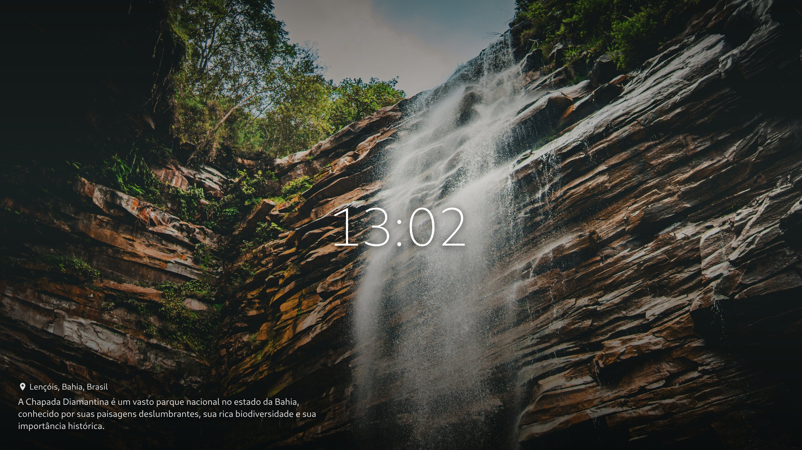

# DeckLive

Tela de espera para TVs e celulares. Enquanto as pessoas aguardam, a tela passa
fotos de lugares, uma de cada vez, com um movimento de câmera bem leve. Junto
com cada foto aparecem a hora, o local e um resumo sobre o lugar.

Para salas de espera e lugares parecidos, dá para pôr na tela as informações do
próprio lugar:

- um aviso em texto;
- uma imagem, como o logo da clínica;
- um quadro com dados de outro sistema que se atualiza sozinho, como a fila de
  atendimento ou a previsão do tempo.

Cada elemento pode ser arrastado para outro ponto da tela. Os ajustes feitos no
celular passam para a TV com um código de seis caracteres.



## Como funciona

São duas partes:

- **API em Rust** (axum + SQLite): escolhe as fotos do acervo do
  [yanlucas.com](https://yanlucas.com) e entrega o texto de cada uma no idioma
  da tela, ou em inglês quando não há tradução.
- **Player web:** roda no navegador da TV ou do celular, sem instalar nada.

As fotos não passam pela API: o navegador baixa direto de `cdn.yanlucas.com`.

A especificação fica em `openspec/` (mudanças `add-photo-player-mvp`,
`add-photo-info-and-motion`, `add-localized-descriptions` e
`add-screen-customization`).

## Como rodar

Com Docker, numa pasta com o código:

```sh
cp .env.example .env
sed -i "s/^DECKLIVE_ADMIN_TOKEN=.*/DECKLIVE_ADMIN_TOKEN=$(openssl rand -hex 24)/" .env
chmod 600 .env
docker compose up -d --build
```

O player abre em `http://127.0.0.1:8083/`. A tela começa vazia: registre as
fotos que ela vai mostrar, pelo `_id` de cada uma no acervo.

```sh
TOKEN=$(sed -n 's/^DECKLIVE_ADMIN_TOKEN=//p' .env)
curl -sS -X POST http://127.0.0.1:8083/api/media \
  -H "Authorization: Bearer $TOKEN" -H 'Content-Type: application/json' \
  -d '{"id": "66d312a4124fa13304b01ea7"}'
```

Para os textos em português, carregue as traduções:

```sh
curl -sS -X PUT http://127.0.0.1:8083/api/translations/pt-BR \
  -H "Authorization: Bearer $TOKEN" -H 'Content-Type: application/json' \
  --data-binary @fixtures/translations/pt-BR.json
```

Sem Docker, com Rust 1.96 e Node 22 ou mais novo:

```sh
npm --prefix web ci && npm --prefix web run build
export DECKLIVE_ADMIN_TOKEN="$(openssl rand -hex 24)"   # no mínimo 32 caracteres
cargo run --release                                    # sobe em http://localhost:8080
```

A configuração completa, as rotas da API, a implantação num servidor e os testes
estão em [docs/referencia.md](docs/referencia.md).
